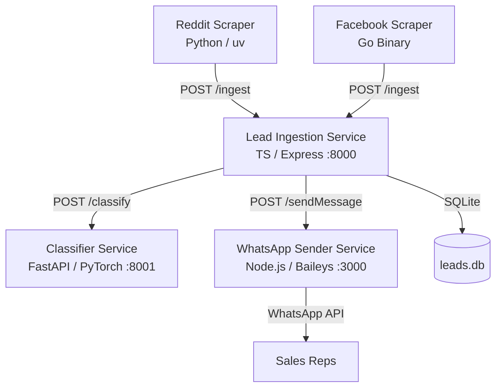

# Cognivelle Ingestion Automation Pipeline

A robust, multi-service ingestion and classification pipeline that scrapes social media posts, filters out non-leads using a fine-tuned Sequence Classification model, extracts contact details, and assigns leads to sales representatives via WhatsApp.

---

## Architecture Overview

The pipeline consists of five microservices communicating locally over HTTP:



### Services Breakdown

1. **`leadIngestion` (Express / TypeScript — Port `8000`):**
   * Acts as the central orchestrator of the pipeline.
   * Performs deduplication using an in-memory cache and a local SQLite database (`leads.db`).
   * Queries the `Classifier Service` for intent classification.
   * Extracts contact information (email, phone, DM intent) with fallback logic.
   * Assigns leads to sales representatives using round-robin distribution mapped to their roles.
   * Triggers outreach notifications through the `whatsappSenderService`.

2. **`finetuning` / Classifier Service (FastAPI / PyTorch — Port `8001`):**
   * A Python sequence classification server (`serve.py`) that loads a fine-tuned `Qwen2.5-0.5B-Instruct` model merged with LoRA weights.
   * Performs high-speed inference on a single forward pass without sampling.
   * Exposes `/classify` to return lead flags (`0` or `1`) and confidence scores.

3. **`whatsappSenderService` (Node.js / Express — Port `3000`):**
   * Connects to WhatsApp using the Baileys library.
   * Displays a QR code in the logs on first login to link a WhatsApp session.
   * Sends outreach notifications containing lead details directly to assigned sales reps.

4. **`RedditScraper` (Python / `uv`):**
   * Polls configured subreddits for posts matching specific topics/keywords.
   * Formats posts and forwards them to the Ingestion Service.

5. **`FbScraper` (Go):**
   * Scrapes designated Facebook groups and forwards posts to the Ingestion Service.

---

## Directory Structure

```
.
├── FbScraper/                # Go-based Facebook scraper
├── RedditScraper/            # Python-based Reddit scraper
├── data/                     # Ignored - Runtime SQLite database storage
├── finetuning/               # Model fine-tuning scripts & FastAPI inference server
│   ├── datasets/             # Dataset folder (sample.csv is tracked)
│   ├── serve.py              # FastAPI model classification server
│   └── .gitignore            # Ignored: Model weights, llama.cpp, venvs
├── leadIngestion/            # TypeScript lead orchestrator service
├── logs/                     # Ignored - Log files for all running services
├── whatsappSenderService/    # Node.js WhatsApp notification gateway
├── run-all.sh                # Main shell script to start all pipeline services
└── .gitignore                # Global gitignore (covers DBs, venvs, logs, archives)
```

---

## Git Exclusion Rules (.gitignore)

To maintain a clean repository and comply with size limits, the following rules are strictly enforced across the `.gitignore` configuration files:

* **No Models or Weights:** All `.safetensors`, `.gguf`, and training checkpoint blobs (`training_args.bin`) are ignored.
* **No Submodule / Local Codebases:** The embedded copy of `llama.cpp` under `finetuning/llama.cpp/` is completely excluded from Git tracking.
* **No Databases:** All SQLite database files (`*.db`, `*.db-shm`, `*.db-wal`, `*.sqlite`) and the root `data/` folder are ignored.
* **No Node Modules or Virtual Environments:** All `node_modules/` and `.venv/` directories are ignored.
* **No Zip / Archives:** All archive types (`*.zip`, `*.tar.gz`, `*.tgz`, `*.gz`, `*.rar`, `*.7z`) are universally blocked.
* **No Local Environment Files:** All `.env` and `.env.*` configuration files are ignored, leaving only `.env.example` templates tracked.

---

## Setup & Running

### Prerequisites

* Node.js (v18+)
* Python (3.11+) and [uv package manager](https://github.com/astral-sh/uv)
* Go (if rebuilding `FbScraper`)

### Running the Entire Pipeline

The root directory contains a unified runner script that bootstraps, builds, and starts all services in the correct sequence.

```bash
# Start all services (auto-installs packages and builds leadIngestion if needed)
./run-all.sh

# Force a clean rebuild/re-install of all Node modules and TypeScript dist files
./run-all.sh --build
```

### Startup Order & Ports

When `./run-all.sh` is executed:
1. **Classifier Service (`:8001`)** starts first and is polled until `/health` reports that model weights are loaded.
2. **WhatsApp Service (`:3000`)** starts and sets up the socket listener.
3. **Ingestion Service (`:8000`)** starts, initializes the SQLite database schema, and loads the sales team.
4. **Scrapers** start last, preventing connection-refused errors when they attempt to ingest posts immediately.

---

## Data Flow Diagram

```
[ Scraped Post ] 
       │
       ▼
 [POST :8000/ingest] ──(Deduplicate via hash check)──► [Already Seen?] ──► Discard (200 OK)
       │
       ▼ [New Post]
 [POST :8001/classify] ──► (FastAPI PyTorch Inference) ──► [Lead Score = 0?] ──► Discard (200 OK)
       │
       ▼ [Lead Score = 1]
 (Regex Contact Extraction) ──► Call / DM / Email
       │
       ▼
 (Round-robin assignment by Role)
       │
       ▼
 [POST :3000/sendMessage] ──► (WhatsApp Web API Gateway) ──► [Sales Representative]
```
